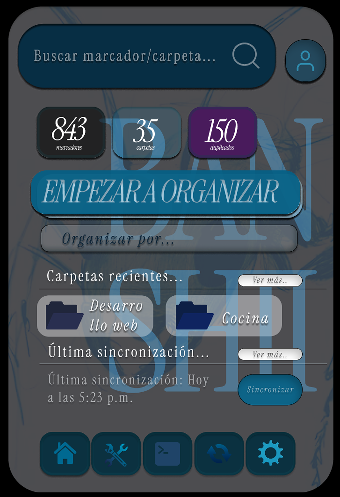

# Banshii

### Un hogar para tus marcadores

Organizador inteligente de marcadores con extensión de navegador, aplicación de escritorio y una vista web de prueba. Busca facilitar la clasificación y recuperación de enlaces.

**Periodo documentado:** 2026  
**Estado:** Producto en desarrollo; código de trabajo privado  
**Tecnologías:** TypeScript · React · Tauri · extensión MV3

## Qué hace

- Organización incremental que conserva una taxonomía aceptada.
- Extensión de navegador para leer y aplicar cambios a marcadores.
- Aplicación de escritorio para análisis y trabajo local.

## Vista del proyecto

La imagen es una maqueta temprana. La interfaz del producto sigue evolucionando.

## Contexto

Proyecto personal.

Esta vitrina contiene únicamente texto e imágenes seleccionadas para presentación. El código fuente, los datos y el historial del proyecto no se publican aquí.

[Ver todos los proyectos](https://alfredoae2578.github.io/)
