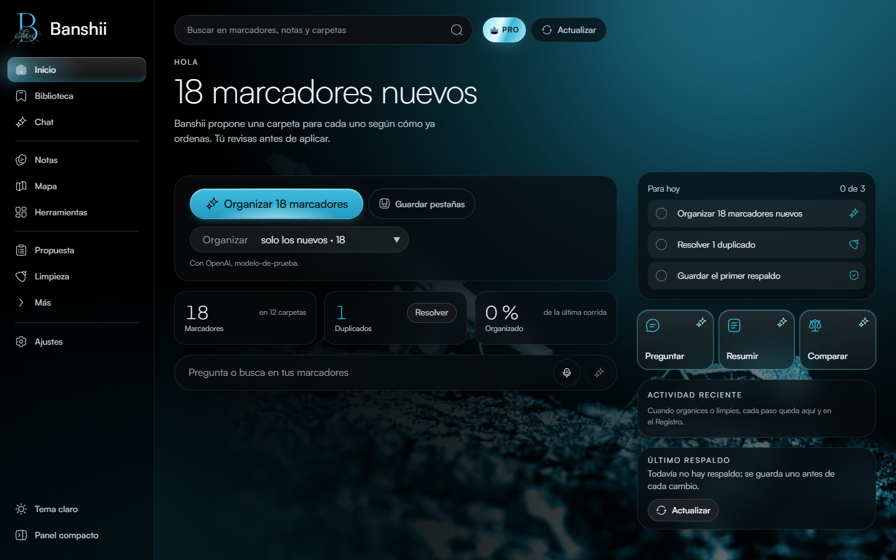
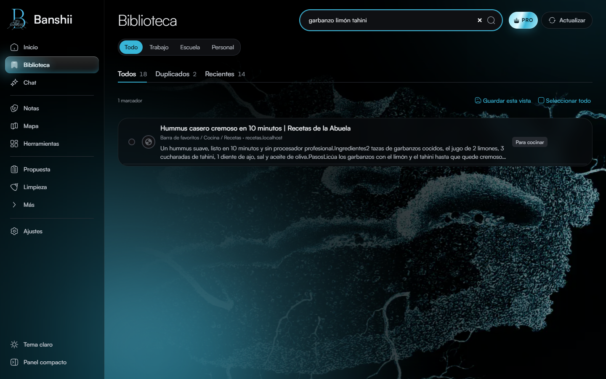
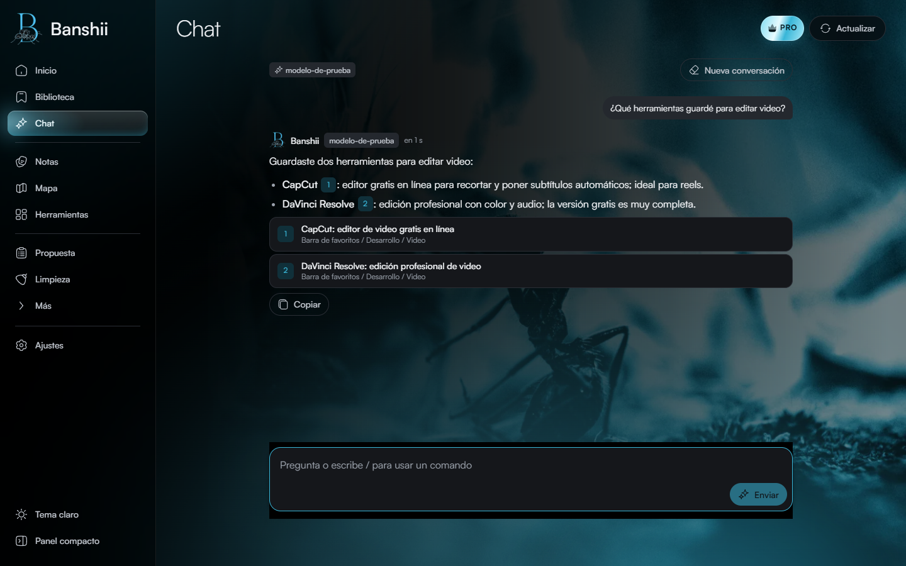
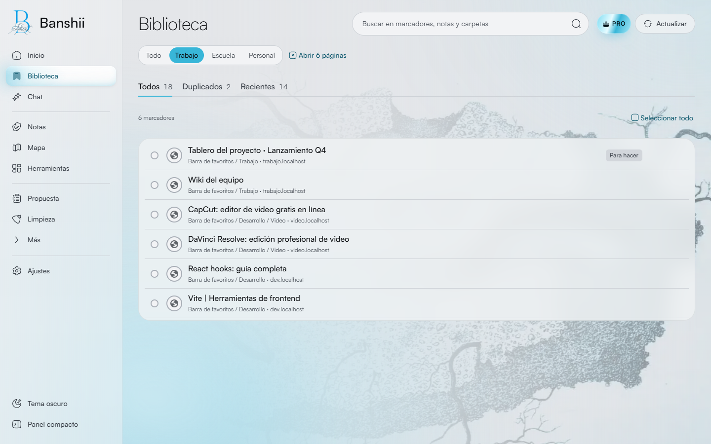
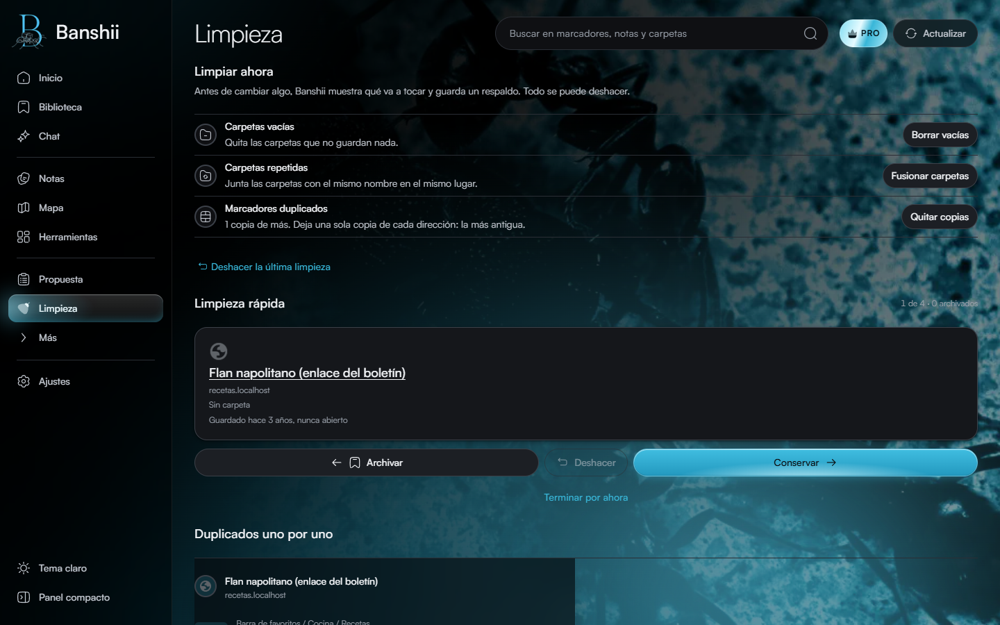
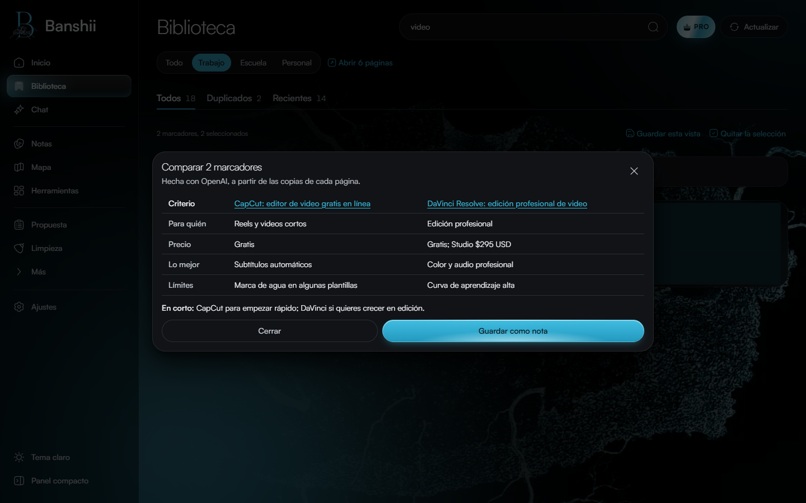
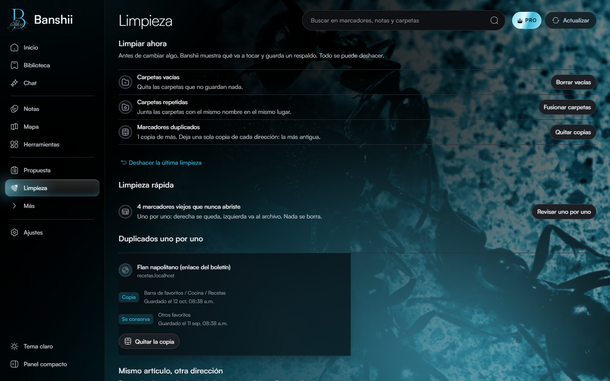

# Banshii

### Un hogar para tus marcadores

Organizador inteligente de marcadores con extensión de navegador, aplicación de escritorio y una vista web de prueba. Busca facilitar la clasificación y recuperación de enlaces.

**Periodo documentado:** 2026  
**Estado:** Producto en desarrollo; código de trabajo privado  
**Tecnologías:** TypeScript · React · Tauri · extensión MV3

## Qué hace

- Organización incremental que conserva una taxonomía aceptada.
- Extensión de navegador para leer y aplicar cambios a marcadores.
- Aplicación de escritorio para análisis y trabajo local.

## Vista del proyecto

Capturas de la versión en desarrollo, realizadas en octubre de 2026 con marcadores de demostración. No contienen la colección personal del autor.

### Inicio de Banshii: organización y acceso a marcadores

### Búsqueda de marcadores por lo que recuerdas

### Interfaz para hacer preguntas sobre los marcadores

### Espacios de trabajo para organizar enlaces

### Vista de limpieza de marcadores

### Comparación de propuestas de organización

### Detección de enlaces duplicados

## Contexto

Proyecto personal.

Esta vitrina contiene únicamente texto e imágenes seleccionadas para presentación. El código fuente, los datos y el historial del proyecto no se publican aquí.

[Ver la ficha visual de Banshii](https://alfredoae2578.github.io/projects/banshii-presentacion.html)

[Ver todos los proyectos](https://alfredoae2578.github.io/)
